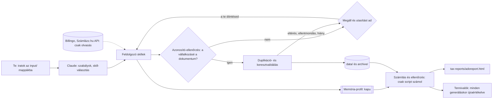

# Használati útmutató

Ez az útmutató azt írja le, **hogyan kell használni a repót**: mit hova kell másolni, milyen sorrendben kell feldolgoztatni, és hogyan kérhetsz dolgokat a Claude-tól (az AI skilleken keresztül).

> ## ⚠️ A legfontosabb szabály: előbb a vállalkozás adatait kell feldolgoztatni
> Az **adóellenőrzés** (`adoellenorzes` skill) **addig nem fut le**, amíg a vállalkozás feldolgozott profilja nincs meg a memóriában (`.claude/memory/vallalkozasi-profil.md`). Ha nincs meg, a script leáll, és kiírja, mit kell előbb csinálni. A profilt a `vallalkozas-dokumentumok` skill készíti el az iratokból (lásd a **2.1 lépést**).
>
> ## ⚠️ Minden beérkező dokumentumot a vállalkozás azonosítójával ellenőrzünk
> Ha egy fájl (számla, NAV-irat, könyvelői irat) **nem a te vállalkozásodra szól** (másik adószám, hiányzó azonosító, másik fiók API-kulcsa), a skill **megáll**, megmondja, mi a tévedés tárgya és mit tegyél, a fájl az `input/` mappában marad. Az azonosítót a `vallalkozas-dokumentumok --billingo` hozza létre (`data/vallalkozas/azonosito.json`); nélküle a skillek nem dolgoznak.

---

## Az AI-workflow röviden (diagram)



Interaktív változatok (nyisd meg böngészőben, nagyítható, kereshető):

- [AI-workflow diagram](docs/ai-workflow.html): ki mit csinál, és hol áll meg a folyamat.
- [Melyik mappába mit, és mi történik vele](docs/mappak-adatfolyam.html): mappánként a skill, a hely, ahová az eredmény kerül, és az ellenőrzés.

## 0. Előfeltételek és telepítés

A telepítő létrehozza a mappákat és a `.env` fájlt (rákérdez a Billingo és a Számlázz.hu API-kulcsra, Enter = kihagyás):

| Rendszer | Parancs |
|---|---|
| Linux, macOS, Git Bash | `./install.sh` |
| Windows (PowerShell) | `.\install.ps1` |

A telepítő ellenőrzi a Python 3.10+ és a `pdftotext` meglétét, létrehozza az `input/` almappákat és a `data/`, `archive/`, `tax-reports/`, `audits/` mappákat, kiegészíti a `.gitignore`-t, majd lefuttatja a számítás önellenőrző tesztjét. Meglévő `.env` esetén a kitöltött értékeket megtartja. Nem interaktív használat: `BILLING_API_KEY=... SZAMLAZZ_API_KEY=... ./install.sh --nem-interaktiv` (PowerShell: környezeti változók, majd `.\install.ps1 -NemInteraktiv`).

| Mit | Hogyan |
|---|---|
| **Python 3.10 vagy újabb** | `python --version`. Külső Python-csomag nem kell, a scriptek a standard könyvtárat használják. |
| **`pdftotext`** (PDF-ek szövegéhez) | A Git for Windows tartalmazza; ellenőrzés: `pdftotext -v`. |
| **API-kulcsok** (`.env`) | `BILLING_API_KEY` (Billingo, csak olvasási), `SZAMLAZZ_API_KEY` (Számlázz.hu Számla Agent), `SZAMLAZZ_SOROZAT` (számlaszám-minta, pl. `ABC-2026-{n}`). Kulcs nélkül az adott forrás kimarad (a futás kiírja). Ne add át és ne írd ki sehova. |
| **Claude Code** a repo gyökerében | A skillek a `.claude/skills/` mappában vannak. |
| *(opcionális)* **Graphify** | A törvénytérkép (`graphify` skill) saját, elszigetelt Python-környezetben él; csak ha a törvényeket gráfként akarod vizsgálni. |

## 1. Mit hova kell másolni

| Mit | Hova | Mi történik vele |
|---|---|---|
| A **vállalkozás iratai** (szerződések, NAV-iratok, bevallások, igazolások, kamarai igazolás, számlák) | `input/vallalkozas-adatok/` | `vallalkozas-dokumentumok`: rendezés `archive/vallalkozas-iratok/` alá, Markdown, profil. A besorolás a mappa- és fájlnevekből történik (`config/iratrend.json`). |
| **NAV adószámla** (XML) és **NAV-bevallások** PDF-ben (2658, 25SZJA, 25EGYSZA, helyi adó kivonat) | `input/nav-egyenleg/` | `adofizetes`: típus és időszak szerint, a duplikátum az `archive/nav-egyenleg/duplikatumok/` mappába kerül. |
| **Adónaptár** (`ÉÉÉÉ.md`): `python -I .claude/skills/adonaptar/scripts/nav_adonaptar.py --ev ÉÉÉÉ` letölti a NAV-ról (szűrve), vagy saját forrásból másolod; a repó nem tartalmaz naptárat | `input/adonaptar/` | `adonaptar`: gépi JSON és memória-kivonat. |
| **Kimenő számlák** fájlban (Billingo/Számlázz.hu PDF, Számla Agent XML, CSV) | `input/bevetelek/` | `szamlak` (`bevetelek.py`): Markdown, a számlák egyesülnek az API-adatokkal; az eredetik: `archive/bevetelek/<év>/`. |
| **Bejövő (kiadási) számlák** PDF-ben | `input/kiadasok/` | `kiadasok-dokumentumok`: számla és díjbekérő szétválasztása, az eredetik: `archive/kiadasok/<év>/`. Más típusú irat esetén megmondja, hová való. |
| A **könyvelőtől kapott iratok** (Utalandó adók/járulékok, Bérösszesítő, 2658) | `input/konyvelo/` | `konyvelo-dokumentumok`: összegek kivonata, összevetés a számítottal; az eredetik: `archive/konyvelo/`. |
| **Hivatalos források és háttéranyagok** (NAV-füzet, vagy egy jegyzet a törvény URL-jével) | `input/torveny/` | `nav-forrasok`: a hivatkozott hivatalos forrást (njt.hu törvény, nav.gov.hu oldal) letölti a `torvenytar/` alá, módosítás nélkül; a jegyzet az `archive/torveny/`-ba kerül. |
| Bármely **más PDF**, amit Markdownná kell alakítani | `input/pdf/` | `pdf-markdown`. |
| A vállalkozó **beállításai** | `config/vallalkozas.json` | Költséghányad, TB-státusz, minimális alap, a folytatás napja, kamara, kedvezmények, IPA, közösségi adószám. A `null` = hiányzik, az érintett számítás „NEM SZÁMOLHATÓ". |
| **Szabályparaméterek** évente | `config/szabalyok_<év>.json` | Minimálbér, adómentes keret, kulcsok. |

A `data/`, `archive/`, `input/`, `tax-reports/` és az `.env` **érzékeny, nincs verziókezelve**.

**Almappák:** az `input/` mappák almappái is feldolgozódnak (pl. `input/kiadasok/2026/…`), a kiterjesztés kis/nagybetűtől független; a feldolgozás után a kiürült almappák törlődnek. Az `input/` feldolgozás után üres: ami ott marad (azonosító-eltérés, ismeretlen irattípus, ellentmondás, nem támogatott formátum miatt), azt az `adoellenorzes` kiírja, és a report Tennivalói között is szerepel.

## 2. A feldolgozás sorrendje

### 2.1 A vállalkozás iratai (EZ AZ ELSŐ, KÖTELEZŐ LÉPÉS)

Skill: **`vallalkozas-dokumentumok`**. A parancsokat a repo gyökeréből futtasd.

```
python -I .claude/skills/vallalkozas-dokumentumok/scripts/dokumentumok.py --leltar      # fájlok, SHA-256, duplikátumok
python -I .claude/skills/vallalkozas-dokumentumok/scripts/dokumentumok.py --konvertal   # PDF -> Markdown
python -I .claude/skills/vallalkozas-dokumentumok/scripts/dokumentumok.py --terv        # besorolási terv; NEM mozgat semmit
python -I .claude/skills/vallalkozas-dokumentumok/scripts/dokumentumok.py --vegrehajt   # áthelyezés, napló (újabb csomagnál bővíti a naplót), SHA-256 ellenőrzés
python -I .claude/skills/vallalkozas-dokumentumok/scripts/dokumentumok.py --billingo    # cégadatok a Billingóból + egyeztetés az iratokkal (eltérésnél megáll)
python -I .claude/skills/vallalkozas-dokumentumok/scripts/dokumentumok.py --profil      # vállalkozói profil -> memória
```

1. **`--leltar`**, **`--konvertal`**, **`--terv`** (nézd át az összesítést: az iratok az évük szerint, `<év>/<témakör>/` alá kerülnek; ami nem sorolható témakörbe, az `<év>/besorolatlan/` mappába), **`--vegrehajt`** (nem töröl semmit, a `--visszaallit` mindent visszarak).
2. **`--billingo`:** a cégadatokat (név, adószám, székhely, közösségi adószám, alanyi adómentesség) összeveti az iratokkal; az értékeket nem írja ki. **Eltérésnél megáll (4-es kód): a Claude megkérdezi, melyik a helyes**; tudomásul vétel után: `--profil --billingo-eltereseket-elfogadom`. Itt készül a vállalkozás azonosítója is.
3. **`--profil`:** a **memóriába** elkészíti a vállalkozói profilt (jogállás, adózási mód, ÁFA, szünetelés, kamara, IPA, kedvezmények, nyitott pontok), mindegyik forrással. Ha a kamarára, a kedvezményekre vagy az IPA-helyre még nincs válasz, **kilistázza, mit kell megkérdezni** (lásd 2.7 és 2.8).

A profil tényeit a Claude az iratokból tölti ki (`data/vallalkozas/profil-tenyek.json`), forrásmappával, **személyes azonosító nélkül**.

### 2.2 Adónaptár

Skill: **`adonaptar`**. `input/adonaptar/ÉÉÉÉ.md`, majd `python -I .claude/skills/adonaptar/scripts/adonaptar.py` (közelgő határidők: `--lista --napok 60`). Eredmény: `data/adonaptar/<év>.json` és memória-kivonat.

### 2.3 NAV adószámla és bevallások

Skill: **`adofizetes`**.

```
python -I .claude/skills/adofizetes/scripts/nav_egyenleg.py     # NAV-adószámla XML + jelentés (adónemenként befizetés, egyenleg, fedezet)
python -I .claude/skills/adofizetes/scripts/bevallasok.py       # NAV-bevallások PDF-ben: típus és időszak a szövegből
```

A `bevallasok.py` **a duplán bemásolt iratot nem dolgozza fel újra**, és ha ugyanarról az időszakról eltérő összegű irat érkezik, megáll és kérdez. Másik adózó dokumentumánál azonosító-eltérés miatt áll meg.

### 2.4 Kimenő számlák: források, egyesítés, validálás

Skill: **`szamlak`**. Források: Billingo (API), Számlázz.hu (API), az `input/bevetelek/` fájljai. Az `adoellenorzes` minden futáskor frissíti őket.

```
python -I .claude/skills/szamlak/scripts/billingo_szamlak.py 2025-01-01 2026-12-31
python -I .claude/skills/szamlak/scripts/szamlazz_szamlak.py 2025-01-01 2026-12-31 --sorozat "ABC-{n}"
python -I .claude/skills/szamlak/scripts/bevetelek.py --feldolgoz
python -I .claude/skills/szamlak/scripts/szamlak_egyesites.py          # keresztvalidálás -> egyesitett_*.json (az adoszamitas ezt olvassa)
python -I .claude/skills/szamlak/scripts/szamla_ellenorzes.py          # megfelelőség az Áfa tv. szerint
```

- **Számlázz.hu:** a Számla Agent csak egy számlát tud lekérdezni számlaszám alapján, ezért a számlaszám-sorozatot járja végig; tömeges exportot az `input/bevetelek/` mappába tegyél. Kulcs nélkül a forrás kimarad, a futás ezt kiírja.
- **Keresztvalidálás:** egy számla csak egyszer könyvelődik. Azonos számlaszám + eltérő adat, vagy gyanúsan azonos számla más számlaszámmal különböző forrásokból **megállítja** az egyesítést (5-ös kód).
- **Idegen dokumentum:** másik vállalkozás számlájánál vagy bejövő számlánál a feldolgozás megáll, megmondja, hová való.

### 2.5 Kiadási számlák

Skill: **`kiadasok-dokumentumok`**: `python -I .claude/skills/kiadasok-dokumentumok/scripts/kiadasok.py --feldolgoz`. Megkülönbözteti a számlát a díjbekérőtől, ellenőrzi a nettó + ÁFA = bruttó összefüggést, a duplán bemásolt iratot nem dolgozza fel újra. Átalányadózónál a költség az adót nem csökkenti; alanyi adómentesként a bejövő számla ÁFA-ja nem levonható (Áfa tv. 187. § (2)).

### 2.6 Könyvelői iratok

Skill: **`konyvelo-dokumentumok`**: `python -I .claude/skills/konyvelo-dokumentumok/scripts/konyvelo.py --feldolgoz`, majd az `adoellenorzes` minden futáskor összeveti lezárt negyedévenként a könyvelő összegeit (SZJA, TBJ, SZOCHO) a számítottal, és a 2658-ak meglétét. A nyomtatvány „Nyomtatva” dátuma nem a beadás napja: a beadás igazolásához NAV beküldési igazolás kell.

### 2.7 Iparűzési adó (IPA)

> **Az IPA-mérték beszerzése a vállalkozói profil része:** a `--profil` kilistázza, ha az IPA módja vagy mértéke hiányzik. A `helyi-ipa` skill a rendeletet a településről keresi meg (a településnév külső szolgáltatáshoz kerül), az eredeti szöveget a `torvenytar/docs/<település>-ipa-rendelet/<év>/` alá menti, a mértéket onnan olvassa ki, és forrással rögzíti.

A profilkészítéskor a Claude rákérdez az illetékességi helyre (`dokumentumok.py --ipa-javaslat`, `--ipa-beallit "<település>"`). Utána a `helyi-ipa` skill (`ipa.py --allapot`, `--mod tetelesen|hagyomanyos`, `--rogzit`, `--szamol`) a helyi rendelet mértékét **forrással** rögzíti, és kiszámolja az éves adót. Kötelező kérdés az adózás módja (tételes vagy hagyományos).

### 2.8a Kedvezmények számítása

A kedvezmények (családi, első házasok, személyi, 25 év alattiak, anyák kedvezményei) számítása **elkészült** (`adoszamitas/scripts/kedvezmenyek.py`, szabályok: `.claude/rules/kedvezmenyek.md`). A jogosult jogcímeket a `config/vallalkozas.json` `kedvezmenyek` mezőjébe kell írni jogosultsági hónapokkal és eltartottak számával (minta: `python -I .claude/skills/adoszamitas/scripts/kedvezmenyek.py --pelda`); a 25 év alatti kedvezményhez a KSH bruttó átlagkeresetét a `config/szabalyok_<év>.json` `brutto_atlagkereset_elozo_julius` mezőjébe kell beírnod. A jogosultság feltételeiért és az adóbevallási nyilatkozatért te felelsz. Az éves szja-t mutatja kedvezmény nélkül és kedvezménnyel; a negyedéves előleg nem változik.

### 2.8 Kamarai hozzájárulás és kedvezmények

A profilkészítéskor a Claude megkérdezi, köteles-e kamarai hozzájárulást fizetni (évi 5 000 Ft, március 31.; 1999. évi CXXI. tv. 34/A. §), és melyik adó- és járulékkedvezményre jogosult: `dokumentumok.py --kamara igen --kedvezmeny nincs`. A kamara külön tételként számolódik; **kedvezmény megadása esetén a számítás még nem implementált, ezt `NEM SZÁMOLHATÓ` jelzéssel kimondja**.

### 2.9 Számlák megfelelősége (Áfa tv.)

A `szamla_ellenorzes.py` számlánként ellenőrzi az Áfa tv. szerinti kötelező tartalmat és az ÁFA-kezelést (169. § adattartalom, 37. § teljesítési hely, 58. § időszakonkénti elszámolás, 163. § kibocsátási határidő, 187. § alanyi adómentesség). A szabályok: `.claude/rules/szamlazas.md`, `afa.md`. A megállapítások nem jogi minősítések; a számlázóprogram adatait vizsgálják, a nyomtatott számlát nem. Hibás számlát az Áfa tv. 170. § szerinti okirattal kell javítani.

### 2.10 Adóellenőrzés és report (csak a profil után fut)

Skill: **`adoellenorzes`**: frissíti az adatokat a többi skill-lel, kiszámolja a kötelezettségeket, összeveti a NAV adószámlával, az adónaptárral és a könyvelői összegekkel, és elkészíti a reportot.

```
python -I .claude/skills/adoellenorzes/scripts/adoellenorzes.py          # az aktuális adóévre
python -I .claude/skills/adoellenorzes/scripts/adoellenorzes.py 2026     # a megadott adóévre
python -I .claude/skills/adoellenorzes/scripts/adoellenorzes.py --nincs-frissites   # hálózat nélkül
```

- **Report:** `tax-reports/adoreport_<év>.html` (világos/sötét, mobilbarát, diagramok, határidők, Vállalkozás adatai, Könyvelői dokumentumok, Beküldött bevallások, Tennivalók, a vállalkozás története).
- **Tennivalók minden generáláskor újraértékelődnek:** a lista a beállításokból, az adatokból és a törvénytárból épül újra; az előző generáláshoz képest kiírja, mennyi **megoldódott** és mennyi az **új**. Tisztázott pont lezárása: `python -I .claude/skills/adoreport/scripts/adoreport.py --lezar ID` (az azonosító a tétel mellett látszik).
- Profil nélkül a script **leáll** (kilépési kód 2). Azonosító-eltérésnél (4) vagy számla-ellentmondásnál (5) szintén leáll, mert hibás adatból nem szabad adót számolni.

## 3. Hogyan kérj dolgokat a Claude-tól

| Mondd ezt | Ezt használja |
|---|---|
| „Dolgozd fel a vállalkozás iratait, és készítsd el a profilt." | `vallalkozas-dokumentumok` |
| „Van elmaradásom? Csináld meg az adóellenőrzést 2026-ra." | `adoellenorzes` (csak profil után) |
| „Mennyi adót kellett fizetnem a számláim alapján?" | `adoszamitas` |
| „Mennyit fizettem be eddig?" | `adofizetes` |
| „Mik a határidők a következő 60 napban?" | `adonaptar` |
| „Töltsd le / dolgozd fel a számláimat." | `szamlak` |
| „Jók a számláim az Áfa tv. szerint?" | `szamlak` (`szamla_ellenorzes.py`) |
| „Dolgozd fel az új kiadási számlákat." | `kiadasok-dokumentumok` |
| „Jól számolt a könyvelő?" | `konyvelo-dokumentumok` |
| „Mennyi az iparűzési adó?" | `helyi-ipa` |
| „Alakítsd Markdownná ezt a PDF-et / keress benne." | `pdf-markdown` |
| „Szerezd be a törvényt / frissítsd a forrásokat." | `nav-forrasok` |
| „Készítsd újra a reportot." | `adoreport` |

A Claude **nem számol fejben**: minden számot script ad, és ami nem ellenőrzött, azt kimondja.

## 4. Mit hova ír a rendszer

| Hely | Tartalom |
|---|---|
| `.claude/memory/` | `vallalkozasi-profil.md` és `adonaptar-<év>.md`; **csak generált, azonosító nélküli adat** |
| `data/` | feldolgozott eredmények: `szamlak/` (köztük `egyesitett_*`, `szamla_ellenorzes.json`), `kiadasok/`, `konyvelo/`, `nav-egyenleg/`, `adonaptar/`, `szamitas/` (köztük `tennivalok_<év>.json`), `ipa/`, `vallalkozas/` |
| `archive/` | a feldolgozott nyers fájlok és a duplikátumok (mozgatás, nem törlés) |
| `tax-reports/` | a HTML adóreport |
| `torvenytar/` | `docs/`: hivatalos források módosítás nélkül (Szja tv., Tbj., Szocho tv., Htv., Áfa tv., Art., kamarai tv., NAV-füzetek, az illetékes önkormányzat IPA-rendelete); `graph/`: a belőlük készült törvénytérkép (Graphify; verziózott, személyes adat nélkül); és az összefoglalók |
| `config/` | beállítások és szabályparaméterek |
| `docs/` | Archify diagramok (AI-workflow, mappák adatfolyama) |
| `audits/` | a repó kiadott auditjai (személyes adat nélkül) és a saját auditjaid (ezeket a telepítő nem teszi a .gitignore-ba) |

## 5. Új adóév vagy új adat

- **Új adóév:** készíts `config/szabalyok_<év>.json`-t a hivatalos értékekkel, másold be az új adónaptárat és NAV-kivonatot, futtasd az `adoellenorzes <év>` parancsot.
- **Új irat:** másold a megfelelő `input/` mappába (lásd az 1. fejezetet), és kérd a feldolgozást; a dokumentumok **azonosító-ellenőrzésen** mennek át.
- **Változott beállítás** (pl. a könyvelő döntött a minimális alapról): módosítsd a `config/vallalkozas.json` mezőit, és futtasd újra az ellenőrzést.

## 6. Hibaelhárítás

| Jelenség | Teendő |
|---|---|
| „LEÁLLT: nincs feldolgozott vállalkozói profil" | Futtasd a 2.1 lépést, különösen a `--profil` parancsot. |
| „MEGÁLLTAM: a dokumentum NEM a te vállalkozásodra szól" | Másik vállalkozás vagy magánszemély dokumentuma került a mappába; ellenőrizd, vidd át a helyes helyre vagy töröld. A fájl nem lett feldolgozva. |
| „a vállalkozás azonosítója még nincs rögzítve" | `dokumentumok.py --billingo` (kell hozzá a `BILLING_API_KEY`). |
| „adóazonosító-jelölt az iratokból" | az adóazonosító jelet az iratokból csak jelöltként olvassuk ki (lehet ügyfélé vagy a könyvelőé is). Ha a kiírt (maszkolt) szám a tiéd: `python -I .claude/scripts/azonosito.py --megerosit-adoazonosito`; addig csak az adószám alapján ellenőrzünk. |
| „LEÁLLT: a kötelező kérdések közül hiányzik válasz" | az adóellenőrzés csak a kamara-, kedvezmény- és IPA-hely kérdések megválaszolása után fut (2.7–2.8); a parancsokat kiírja. |
| „nincs … évet lefedő számlafájl" | a számlafájlnak az előző év január 1-jétől kell indulnia: `billingo_szamlak.py <előző év>-01-01 <adóév>-12-31` (az `adoellenorzes` ezt maga elvégzi). |
| „a BILLING/SZAMLAZZ_API_KEY másik vállalkozás fiókjához tartozik" | Cseréld a `.env`-ben a kulcsot a saját fiókodéra. |
| „ELLENTMONDÁS" / „gyanús duplikáció" (számla) | Nézd meg a felsorolt számlákat az eredeti rendszerben; javítsd vagy töröld a hibás forrásfájlt, és futtasd újra. |
| „ez nem kiadási számla, hanem …" | A fájl rossz mappában van; a hibaüzenet megmondja, hová tedd. |
| „nem találom a pdftotext programot" | Telepítsd (Git for Windows tartalmazza). |
| Billingo 401/403 | Ellenőrizd a `BILLING_API_KEY`-t (csak olvasási kulcs). |
| „NEM SZÁMOLHATÓ – hiányzó beállítás" | Töltsd ki a `config/vallalkozas.json` megjelölt mezőjét, vagy válaszolj a profilkérdésre. |
| Az iratok rossz helyre kerültek | `--visszaallit`, majd a `config/iratrend.json` javítása, és újra `--terv`. |
| Szkennelt PDF-nek nincs Markdown-ja | OCR nincs; a fájl áthelyezhető, de szövege nem kereshető. |

## 7. Alapelvek (mindig érvényesek)

1. **Számítást csak script végez**, soha nem az AI; nincs becslés. Ami nem ellenőrzött, azt kimondja.
2. A **személyes azonosítók** (adószám, TAJ, cím, bankszámla, API-kulcs) nem kerülnek a chatbe, a memóriába vagy a reportba.
3. A **`torvenytar/docs/` forrásfájljait** nem módosítjuk.
4. **Nem vagyunk adótanácsadók:** a döntést igénylő pontokat (minimális alap, árfolyam, helyesbítés, összesítő nyilatkozat) a könyvelővel vagy a NAV-val kell tisztázni.

A részletes szabályok: `.claude/rules/` (`adatkezeles.md`, `nincs-becsles.md`, `struktura.md`, `atalanyado.md`, `jarulek-szocho.md`, `bevetel-nyilvantartas.md`, `hataridok.md`, `afa.md`, `szamlazas.md`, `kamarai-hozzajarulas.md`).

## A `config/vallalkozas.json` mezői (a `null`-t te töltöd ki, a scriptek nem találnak ki értéket)

| Mező | Jelentés |
|---|---|
| `tb_statusz` | `fofoglalkozasu`, `munkaviszony_36_vagy_nappali` vagy `nyugdijas` |
| `min_alap_tipus`, `min_alap_tipus_megerositve` | `minimalber` / `garantalt` (csak főfoglalkozásúnál); a megerősítést a könyvelő/NAV adja |
| `vallalkozas_elso_napja` | a vállalkozás **első** napja: ennél korábbi határidők nem relevánsak. Régebbi, szünetelés után újraindult vállalkozásnál töltsd ki, különben a korábbi határidők (előző évi bevallás, kamara) kiesnek az ellenőrzésből |
| `vallalkozas_kezdete` | a jelenlegi jogviszony kezdete (újraindulásnál az újraindulás napja) |
| `szunetelesek` | `[{"tol": "ÉÉÉÉ-HH-NN", "ig": "ÉÉÉÉ-HH-NN"}]`: év közbeni szünetelés; a napjai kimaradnak az időarányos határból és a töredékhónapos minimális alapból (értelmezés, nem ellenőrzött) |
| `kamara_koteles`, `kedvezmenyek`, `ipa_telepules` | a vallalkozas-dokumentumok skill kérdezi meg és rögzíti |

**Ha a számlaforrások közül nem mindegyikhez van kulcs:** az `adoellenorzes` kiírja, melyik forrás hiányzik (Billingo / Számlázz.hu / fájlok); a hiányzó forrás bevétele nincs benne a számításban.
**Részben fizetett számla** nem számít bele a bevételbe (a részösszeg nem érhető el): a futás 🔴-vel jelzi.
